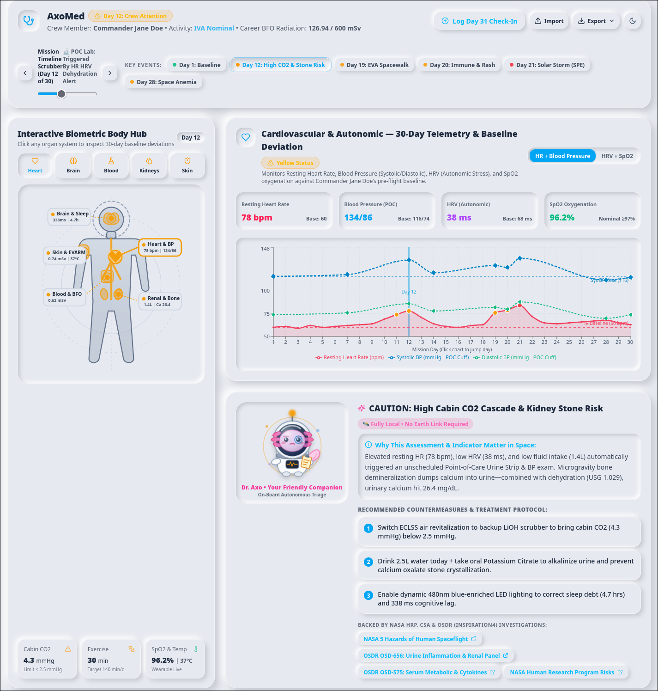
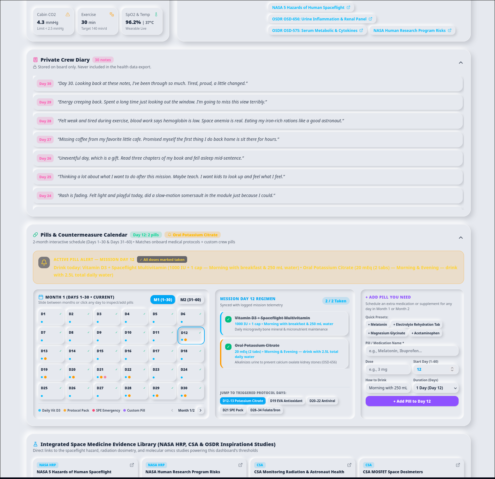
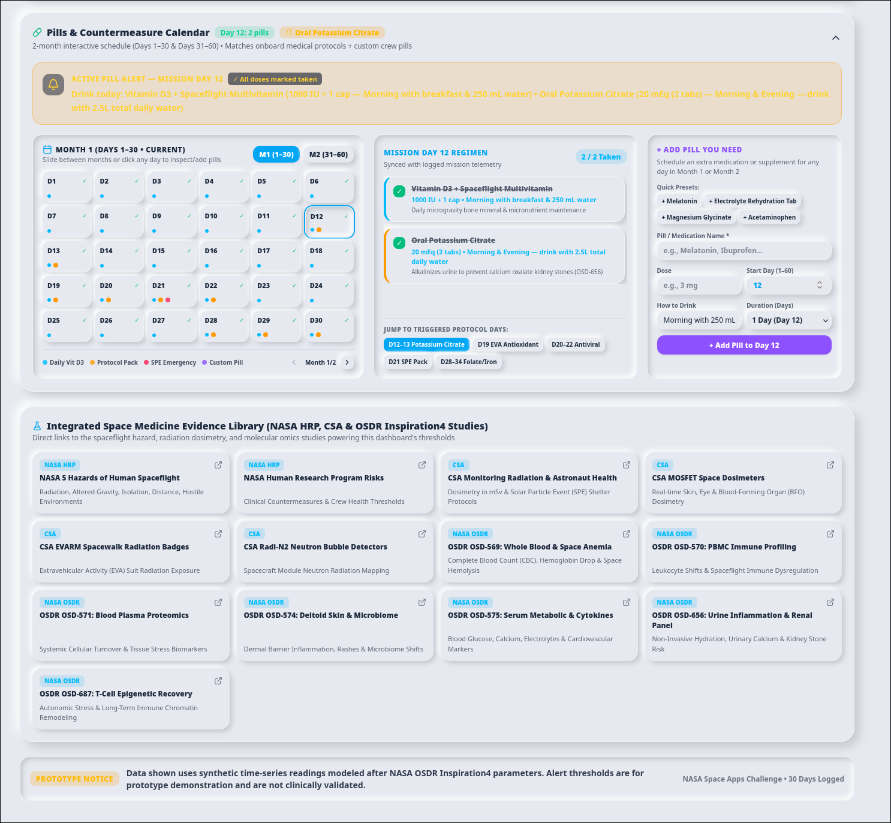
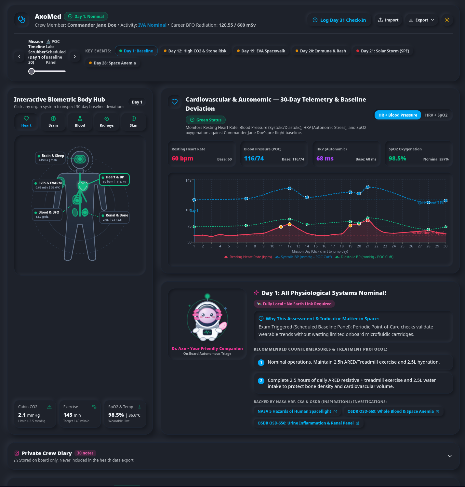
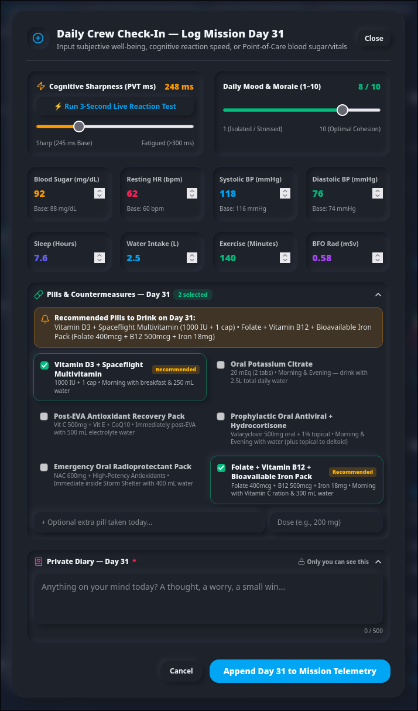
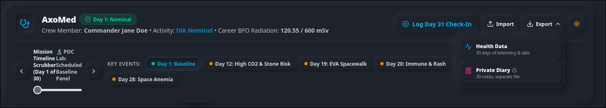

# 🚀 AxoMed – Autonomous Astronaut Health Monitor

> **NASA Space Apps Challenge 2026**  
> **Challenge:** [Create Health Monitoring Software for Astronauts on Space Missions](https://www.spaceappschallenge.org/2026/challenges/health-monitoring-software/?tab=details)

🔗 **[Live Demo](https://noname686.github.io/axomed/)**

<details>
<summary>📸 <strong>Screenshots Album (Click to expand)</strong></summary>

<br>

| | | |
| :---: | :---: | :---: |
|  |  |  |
|  |  |  |

</details>

> **Note:** AxoMed is a **visual & interactive UI prototype** powered by a **synthetic 30-day dataset** for demonstration purposes (not connected to live spacecraft sensors and not clinically validated).

---

## 🌌 The Problem
As humanity prepares for long-duration missions to the Moon (Artemis) and Mars, astronauts will face extreme isolation, hostile environments, and **communication delays of up to 20 minutes each way** (plus potential communication blackouts). They cannot rely on flight surgeons or cloud services on Earth for real-time medical assessments. Astronauts need an intuitive, **100% local onboard tool** to track their physiological and psychological baselines, spot anomalies early, and take preventative action autonomously.

---

## 💡 Our Solution & Local-First Philosophy
**AxoMed** is a **visual prototype** of an interactive, self-monitoring medical dashboard designed around a core architectural principle: **everything should run locally on board**.

* **No Earth Link Required:** Telemetry review, triage rules, private journaling, and medication tracking are designed to operate offline inside the spacecraft or habitat.
* **Local AI Principle:** In this prototype, **Dr. Axo** uses deterministic, rule-based triage logic backed by published NASA/CSA research. If a generative or predictive AI model is integrated in a future flight version, **we believe it must also run 100% locally on onboard hardware**—never relying on cloud APIs on Earth—to guarantee zero-latency triage during deep-space delays and keep sensitive crew health and diary data completely private.

### ✨ Key Features
* **🧍 Interactive Biometric Body Map:** A clickable, color-coded SVG astronaut figure (`Green` = Nominal, `Yellow` = Attention, `Red` = Critical) covering 5 physiological systems (**Heart & BP**, **Brain & Sleep**, **Blood & Marrow**, **Kidneys & Bone**, **Skin & Immune**) for an instant visual health assessment.
* **📈 Baseline Trend Analysis & Scenario Presets:** Dynamic multi-parameter **Recharts** time-series charts tracking Resting HR, Blood Pressure, HRV, $\text{SpO}_2$, Sleep Quality, Cognitive PVT Speed, Cabin $\text{CO}_2$, Exercise, Hemoglobin, Hydration, Urinary Calcium, and Radiation Exposure across a 30-day mission timeline—plus one-click **Clinical Scenario Presets** (Days 1, 12, 19, 20, 21, and 28).
* **📝 Daily Crew Check-In (Day 31+):** Log subjective mood, vitals, and Point-of-Care labs, run a built-in **3-second interactive NASA PVT cognitive reaction timer**, select daily pills/countermeasures, and record a private diary note.
* **🛡️ Dr. Axo Autonomous Triage & Countermeasures:** Explains *why* an alert or exam was triggered in space and prescribes step-by-step protocols (e.g., backup $\text{LiOH}$ $\text{CO}_2$ scrubber & Potassium Citrate on Day 12, Polyethylene Storm Shelter & radioprotectants during Day 21's Solar Particle Event, or Folate/B12/Iron & LBNP for Day 28 Space Anemia).
* **📓 Private Crew Diary (Local-Only):** A foldable diary section with 30 days of crew notes and required Check-In reflections—stored separately from medical telemetry and **never included in health data exports**.
* **💊 Pills & Countermeasure Calendar (2-Month Slider):** A foldable, slidable 2-month calendar (**Days 1–30** & **Days 31–60**) synced with onboard medical protocols, featuring an explicit **Active Pill Alert Banner** stating exact doses and timing, one-click completion tracking, and custom pill scheduling.
* **📦 Separate JSON Export & Import:** Download **Health Data** (`axomed_health_data_<N>d.json`) or **Private Diary** (`axomed_private_diary_<N>notes.json`) independently, and restore either file back into the app with auto-detection.
* **🌗 Soft Alabaster & Deep-Space Dark Neumorphic UI:** Built for comfortable viewing in both bright cabin lighting and low-light crew quarters.

---

## 🧬 How We Used NASA & Space Agency Resources
To ensure our alert rules and medical guidance weren't arbitrary, we built our software logic around real space-medicine research (linked directly inside the dashboard's **Integrated Space Medicine Evidence Library**):

1. **NASA Human Research Program (HRP) – 5 Hazards & Risks of Spaceflight:** Used to map environmental hazards (Radiation, Altered Gravity, Isolation, Distance, Hostile Environments) to physiological indicators and define recommended countermeasures.
2. **NASA Open Science Data Repository (OSDR) – Inspiration4 Studies (`OSD-569`, `OSD-570`, `OSD-571`, `OSD-574`, `OSD-575`, `OSD-656`, `OSD-687`):** Referenced to select realistic biometric and omics indicators including Space Anemia / hemolysis, leukocyte/immune shifts, deltoid skin microbiome rashes, metabolic cytokines, urinary calcium / kidney stone risk, and autonomic HRV recovery.
3. **Canadian Space Agency (CSA) Radiation Research (`CSA-Rad-2026`, `MOSFET`, `EVARM`, `Radi-N2`):** Used to design the Blood-Forming Organ (BFO) vs. EVA skin radiation dosimetry tracker (measured in `mSv` against the `600 mSv` career and `250 mSv` 30-day limits) and Solar Particle Event (SPE) shelter protocols.

### ⚠️ Scientific & Data Disclaimer
* **Synthetic Data Usage:** In accordance with challenge guidelines, this prototype utilizes a **30-day simulated time-series dataset** modeled after physiological parameters tracked in NASA OSDR Inspiration4 studies, including nominal baseline days and simulated spaceflight anomalies (**Day 12** $\text{CO}_2$ + renal stone risk, **Day 19** EVA radiation, **Day 20** immune/dermal rash, **Day 21** Solar Particle Event, and **Day 28** Space Anemia).
* **Prototype Thresholds:** Alert rules and biometric thresholds are inspired by published spaceflight literature for demonstration purposes only and are **not clinically validated for medical diagnosis**.

---

## 🛠️ Tech Stack
* **Frontend:** React 18 + TypeScript + Vite 6
* **Styling:** Tailwind CSS v4 (Custom Neumorphic UI & SVG Body Map)
* **Data Visualization:** Recharts
* **Icons:** Lucide React
* **Data Storage & Portability:** Local in-memory simulated dataset with separate Health & Diary JSON Export / Import
* **CI/CD:** GitHub Actions + Bun → GitHub Pages

---

## 🚀 How to Run the Project Locally

1. **Clone the repository:**
   ```bash
   git clone https://github.com/noname686/axomed.git
   cd axomed
   ```

2. **Install dependencies:**
   ```bash
   bun install
   # or: npm install
   ```

3. **Start the development server:**
   ```bash
   bun run dev
   # or: npm run dev
   ```

4. **Build for production:**
   ```bash
   bun run build
   # or: npm run build
   ```

---

## 🤖 AI / Super Intelligence (SI) Disclosure
AI coding assistants were used for help in React/TypeScript implementation and debugging, to create synthetic dataset/diary generation, and edit documentation, under the direction of the project author.

---

## 📄 License
This project is licensed under the [MIT License](LICENSE).
